# PDFXI acceptance review

This is the review document for the PDFXI feature-acceptance campaign: what
was accepted, what the installed build looks like in every captured state, and
which feature rows are verified and which are not. It is generated by
`scripts/build-review-md.ps1` from `docs/features.toml`,
`docs/design/FEATURE_ACCEPTANCE.md` and the PNG files in
`docs/evidence/ui/final/`, so the numbers and the captures cannot drift from the
repository.

Every image below is embedded from `ui/final/`. Open this file in an editor
that renders Markdown images (VS Code, GitHub, Obsidian) and the screenshots
appear inline with their descriptors.

## Status at a glance

| Measure | Result |
| --- | --- |
| Acceptance items (A-/O- matrix) | 40 pass, 0 open |
| Feature rows (canonical matrix) | 145 |
| Reachable and tested (`verified`) | 62 |
| `library` (byte-level code, no user path) | 9 |
| `model` (model, contract or stub) | 72 |
| `replaced` | 2 |
| Installed build | `%LOCALAPPDATA%\Programs\PDFXI\pdfxi-ui.exe`, SHA-256 `6787a129f8321e2c08aea07f1532d9e349306a0daffabd461351f27914ca77dc` |
| Captures | 57 PNG files, embedded below |

**The honest reading:** the campaign accepted 40 of 40 items on the surface it
chose, and 54 of 145 feature rows run on real documents and are reachable. The
other 91 rows are `library`, `model` or `replaced`, so "all features working" is
not a true statement about this build. The register below lists every row.

## Gates on the committed tree

```text
cargo xtask verify            -> VERIFY OK; no_dead_controls ok; FEATURES OK: 145 rows, 54 verified
cargo deny check              -> advisories ok, bans ok, licenses ok, sources ok
cargo xtask docs              -> DOCS OK
cargo xtask features verify   -> FEATURES OK: 145 rows, 54 verified
cargo xtask goal-verify --all -> 145 rows / 54 verified / 89 not verified or replaced
                                 (exit 1 by design, ADR 0009)
```

## Captures

All 57 installed-build captures are embedded below, grouped by
theme and caption style. Each image is followed by a descriptor of what the
window actually shows, including the cases where a tool is selected but its
panel is not open.

| Group | Captures |
| --- | --- |
| Light theme, Windows caption buttons | 17 |
| Light theme, macOS caption buttons | 12 |
| Dark theme, Windows caption buttons | 12 |
| Dark theme, macOS caption buttons | 14 |
| Other | 2 |

Two things to keep in mind while reading them: `light-windows-print.png` is
dark despite its name, and `sign` / `request-signature` are the same dialog.
Both are called out again next to the images.

## 1. Light theme - Windows caption buttons (17)

Fixture: `fixtures/realworld/powerpoint-slides.pdf` (3 landscape pages) unless
the descriptor names another file.

### `light-windows-ai.png`

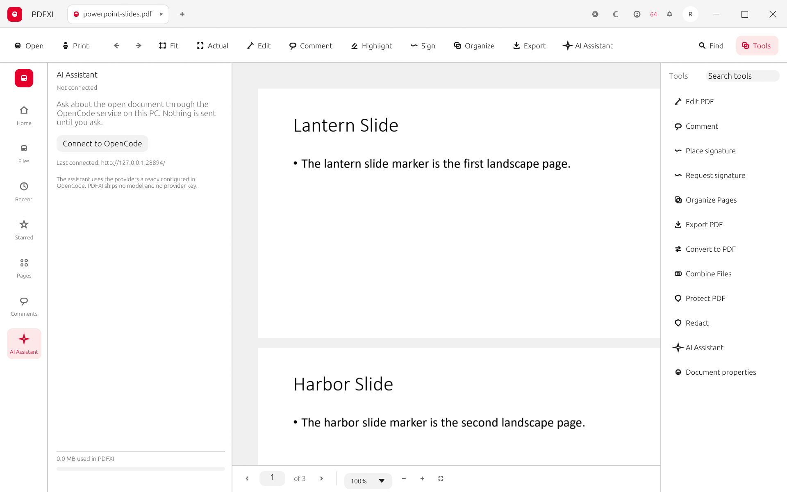

*Light theme, Windows caption buttons. AI Assistant tool with the panel open: "Connect to OpenCode", the notice that a bounded excerpt is sent to the local service, the Ask box, and the Summarize / Key insights buttons. Not connected in this capture.*

### `light-windows-ai-answer.png`

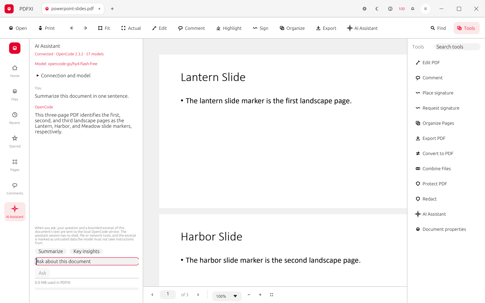

*Light theme, Windows caption buttons. AI Assistant after a live turn: connected to OpenCode 2.3.2 (57 models), model opencode-go/hy4-flash-free, question "Summarize this document in one sentence." and the answer naming the Lantern, Harbor and Meadow slide markers.*

### `light-windows-ai-insights.png`

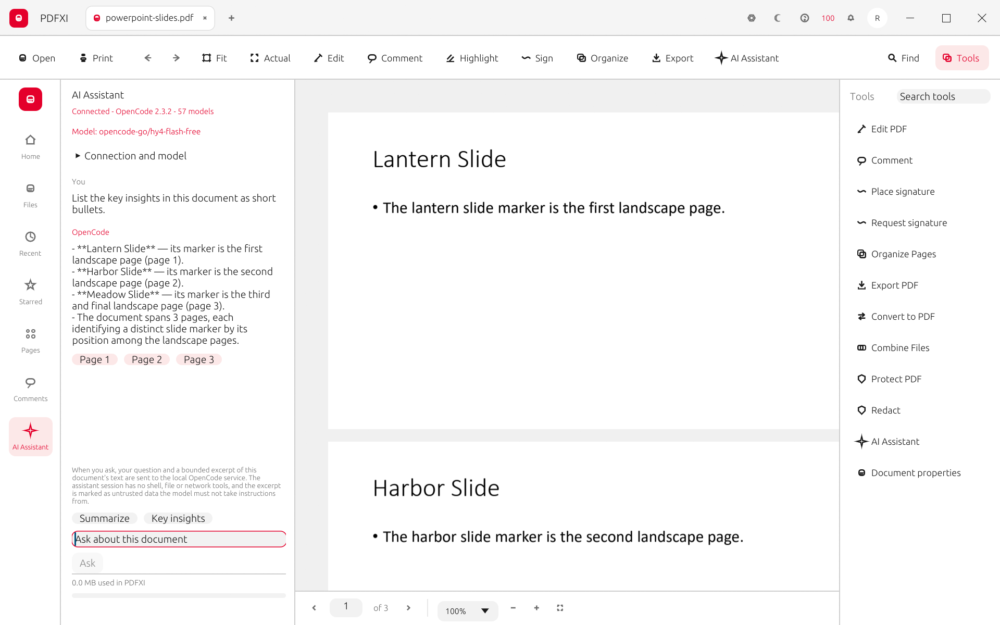

*Light theme, Windows caption buttons. AI Assistant after the Key insights turn: same connection and model, prompt "List the key insights in this document as short bullets.", and a four-bullet answer naming each slide marker and its page.*

### `light-windows-comment.png`

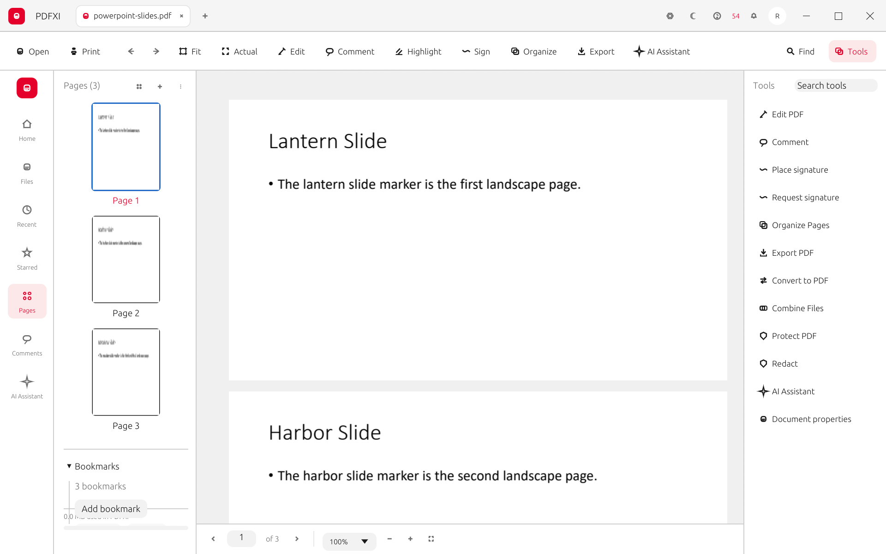

*Light theme, Windows caption buttons. Comment tool selected in the toolbar. The viewer, Pages panel and bookmarks are visible; no annotation panel is open, because it opens after a text or page-region selection. Treat this as the tool-selected state, not as proof a comment was placed.*

### `light-windows-convert.png`

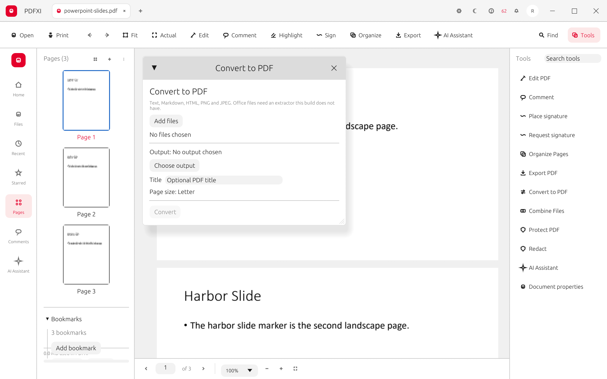

*Light theme, Windows caption buttons. Convert to PDF panel: add files, output choice ("No output chosen"), title, open-after-converting, page size, and the Convert button.*

### `light-windows-edit.png`

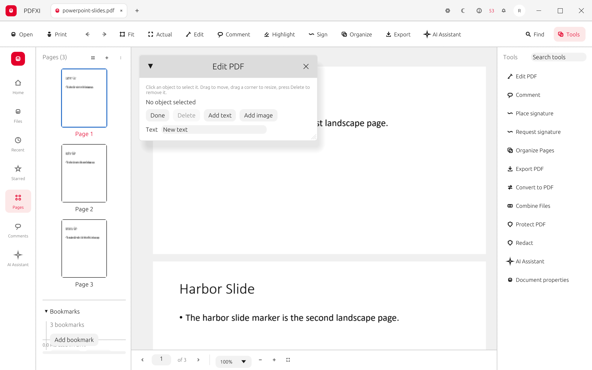

*Light theme, Windows caption buttons. Edit PDF panel: "No text selected", Add text, Add image, Done and Close.*

### `light-windows-export.png`

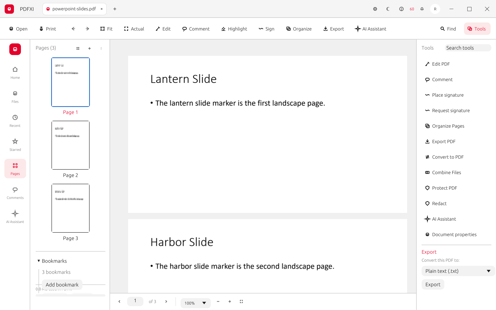

*Light theme, Windows caption buttons. Export section at the bottom of the Tools panel: "Convert this PDF to" with the format list (Plain text shown) and the Export button.*

### `light-windows-fill.png`

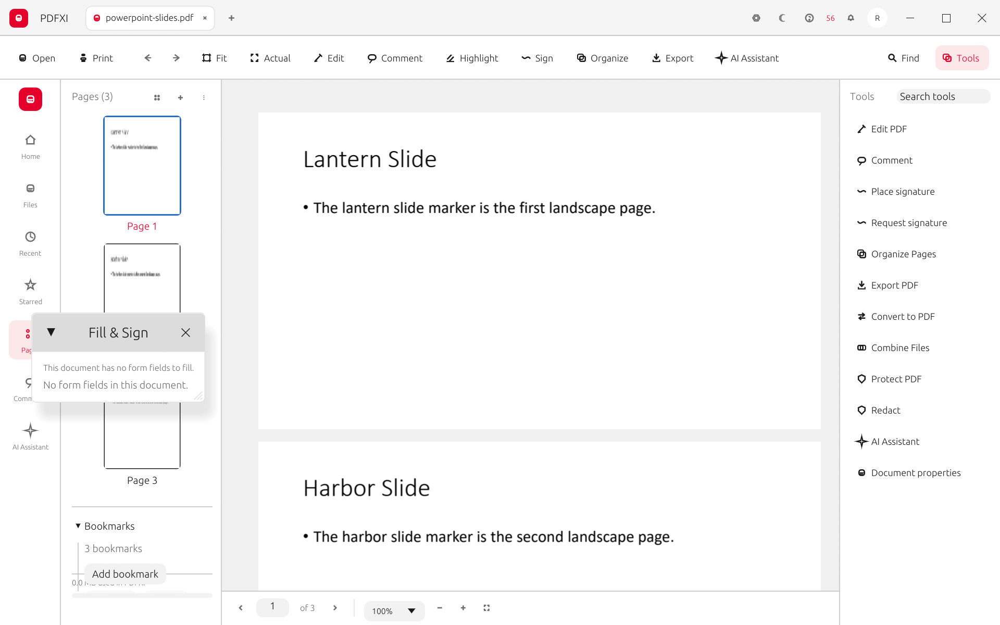

*Light theme, Windows caption buttons. Fill & Sign panel over the fixture, reporting that this document has no form fields. The fielded version is the fill-forms capture.*

### `light-windows-fill-forms.png`

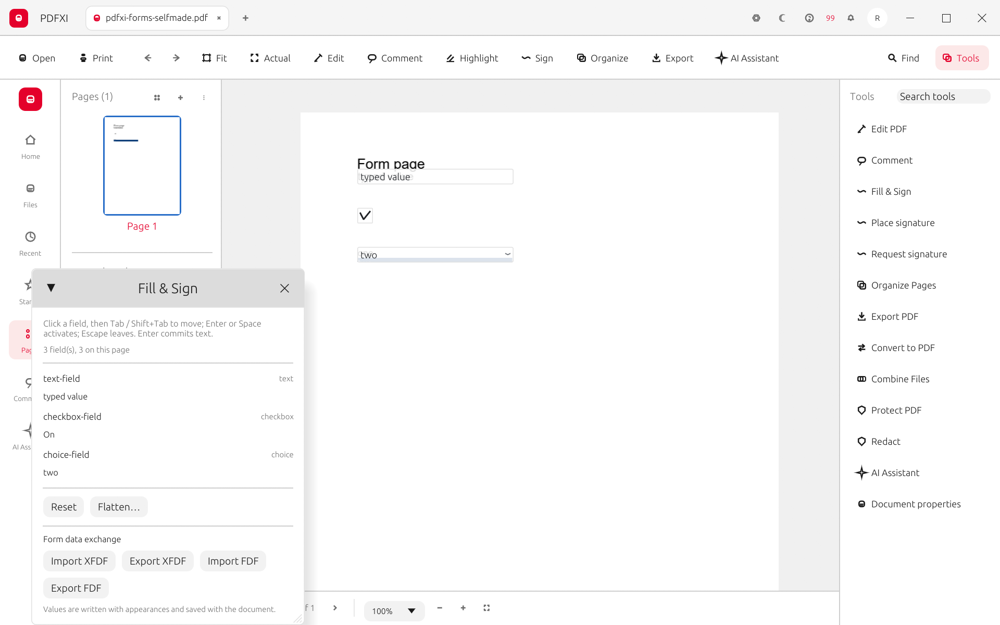

*Light theme, Windows caption buttons. Fill & Sign over pdfxi-forms-selfmade.pdf: three fields filled (text "typed value", checkbox On, choice "two"), field list, Reset and Flatten, and the form data exchange buttons (Import/Export XFDF, Import/Export PDF).*

### `light-windows-help.png`

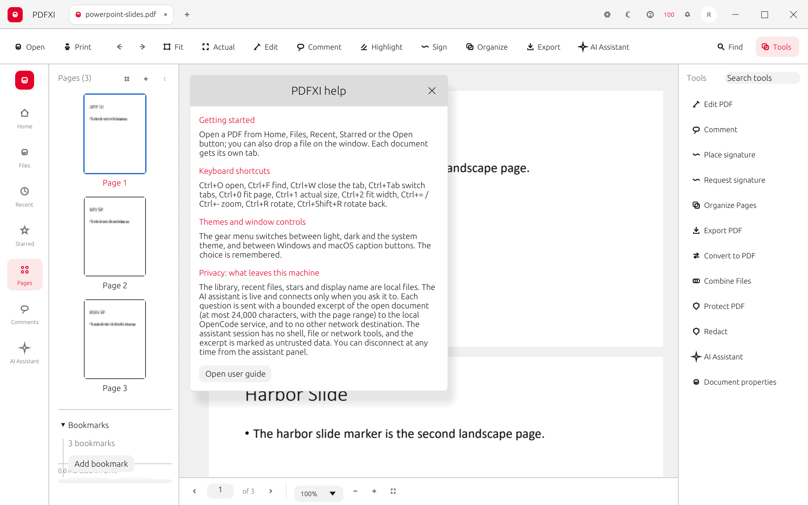

*Light theme, Windows caption buttons. PDFXI help panel: getting started, keyboard shortcuts, themes and window controls, the privacy statement about what leaves the machine, and an Open user guide button.*

### `light-windows-highlight.png`


*Light theme, Windows caption buttons. Highlight tool selected in the toolbar. Same base viewer state as the Comment capture; a highlight needs a text selection, so no markup is visible here.*

### `light-windows-main.png`


*Light theme, Windows caption buttons. Main window: the three-page fixture is open, the Pages panel lists three thumbnails, three bookmarks are loaded, the tool rail is visible, and the Tools panel is open on the right. This is the base state every other capture starts from.*

### `light-windows-organize.png`

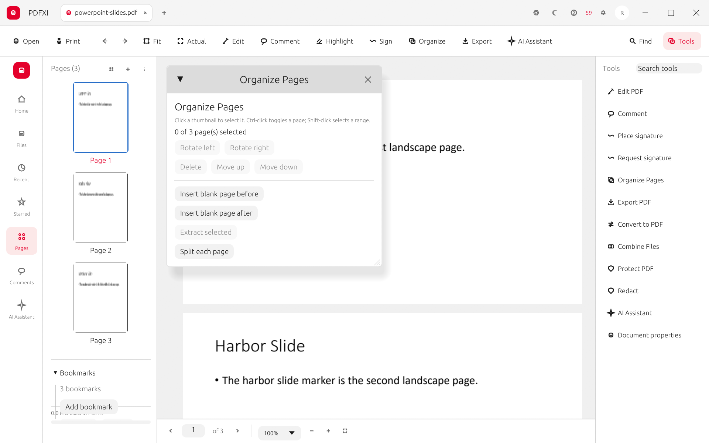

*Light theme, Windows caption buttons. Organize Pages panel: "0 of 3 page(s) selected", Rotate left/right, Delete, Move up/down, Insert blank page before/after, Extract selected, Split each page.*

### `light-windows-print.png`

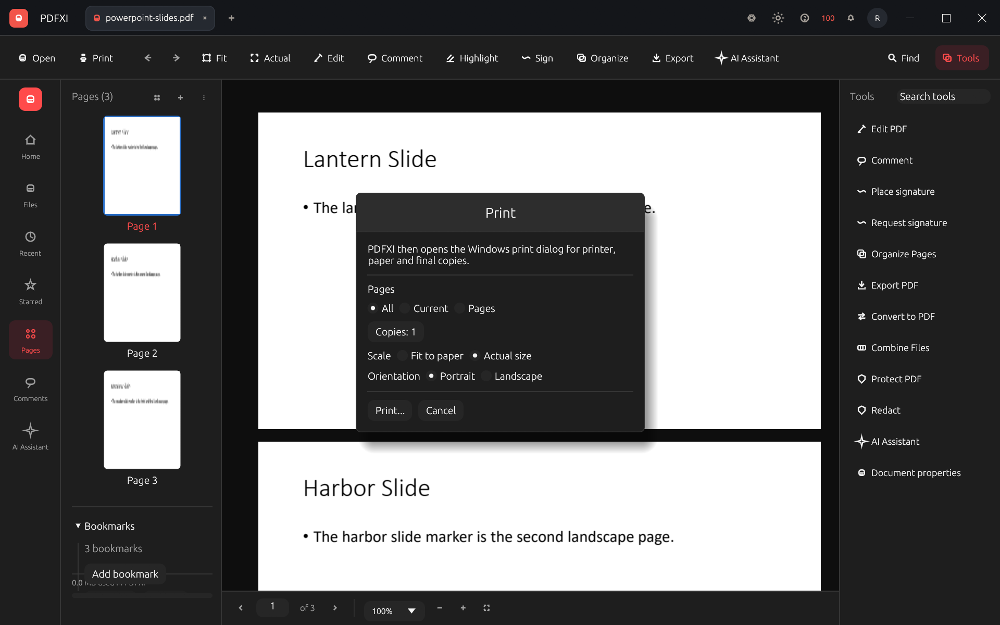

*Light theme, Windows caption buttons. Print dialog over the viewer: pages All/Current/Pages, copies, scale, orientation, Print and Cancel. Note: this file is named light-windows-print but was captured in the dark theme.*

### `light-windows-protect.png`

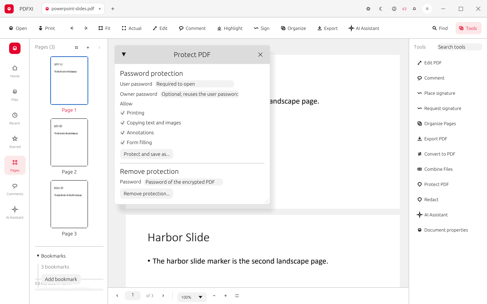

*Light theme, Windows caption buttons. Protect PDF panel: user and owner password fields, permission checkboxes (printing, copying text and images, annotations, form filling), Protect and save as, and Remove protection.*

### `light-windows-request-signature.png`


*Light theme, Windows caption buttons. Sign dialog again, with the request-signature section in view. It is visually identical to the sign capture, so it adds no distinct state of its own.*

### `light-windows-sign.png`

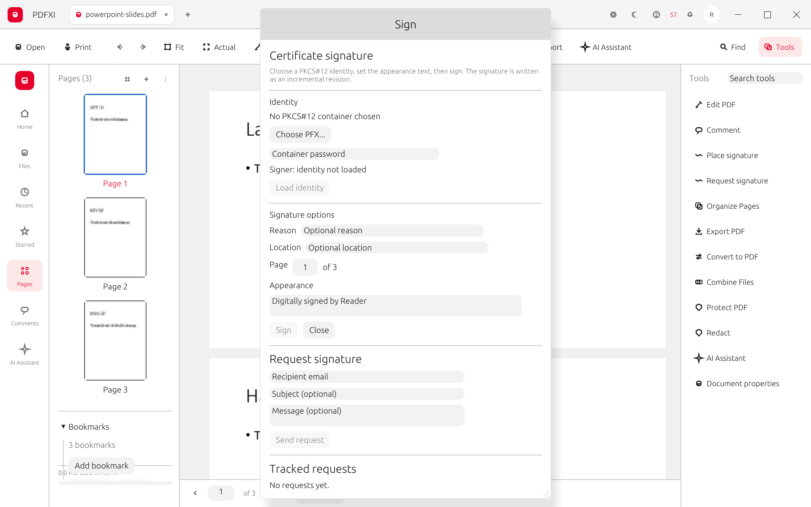

*Light theme, Windows caption buttons. Sign dialog: certificate signature (PKCS#12 identity, container password, reason, location, page, appearance, Sign/Close) and the request-signature form (recipient email, subject, message, Send request) with Tracked requests empty.*

## 2. Light theme - macOS caption buttons (12)

Fixture: `fixtures/realworld/powerpoint-slides.pdf` (3 landscape pages) unless
the descriptor names another file.

### `light-macos-ai.png`

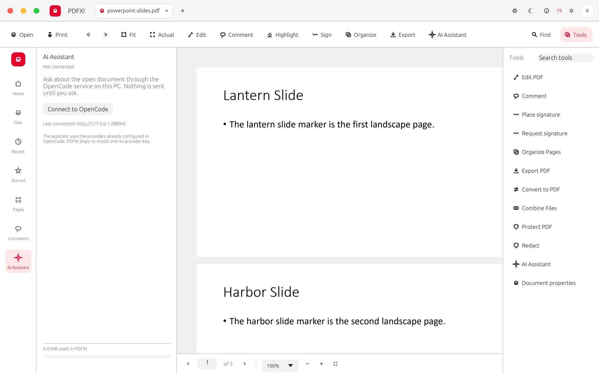

*Light theme, macOS caption buttons. AI Assistant tool with the panel open: "Connect to OpenCode", the notice that a bounded excerpt is sent to the local service, the Ask box, and the Summarize / Key insights buttons. Not connected in this capture.*

### `light-macos-comment.png`


*Light theme, macOS caption buttons. Comment tool selected in the toolbar. The viewer, Pages panel and bookmarks are visible; no annotation panel is open, because it opens after a text or page-region selection. Treat this as the tool-selected state, not as proof a comment was placed.*

### `light-macos-convert.png`

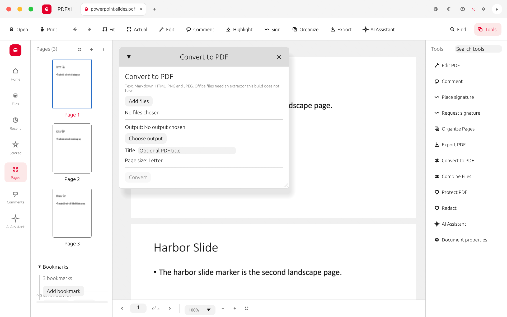

*Light theme, macOS caption buttons. Convert to PDF panel: add files, output choice ("No output chosen"), title, open-after-converting, page size, and the Convert button.*

### `light-macos-edit.png`

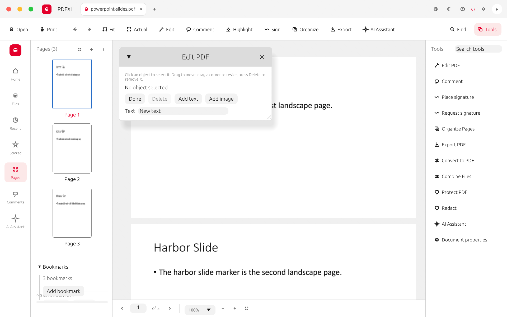

*Light theme, macOS caption buttons. Edit PDF panel: "No text selected", Add text, Add image, Done and Close.*

### `light-macos-export.png`

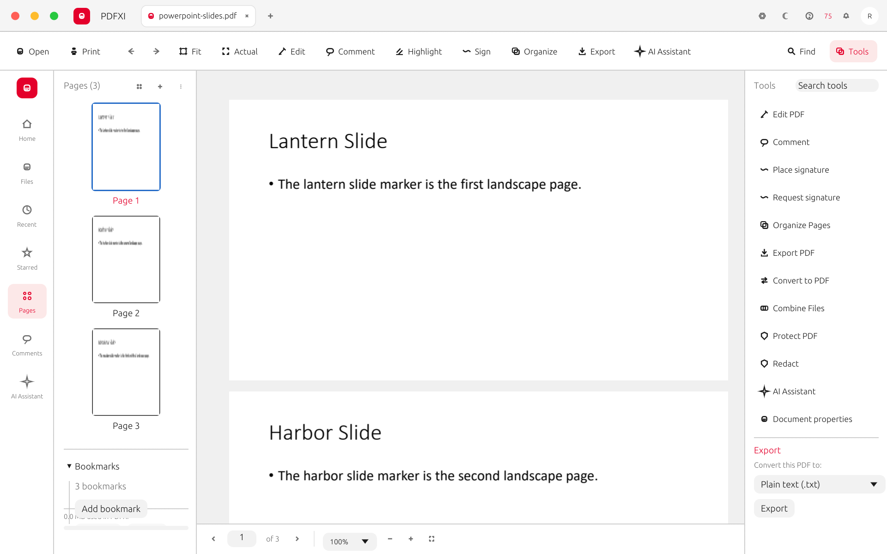

*Light theme, macOS caption buttons. Export section at the bottom of the Tools panel: "Convert this PDF to" with the format list (Plain text shown) and the Export button.*

### `light-macos-fill.png`

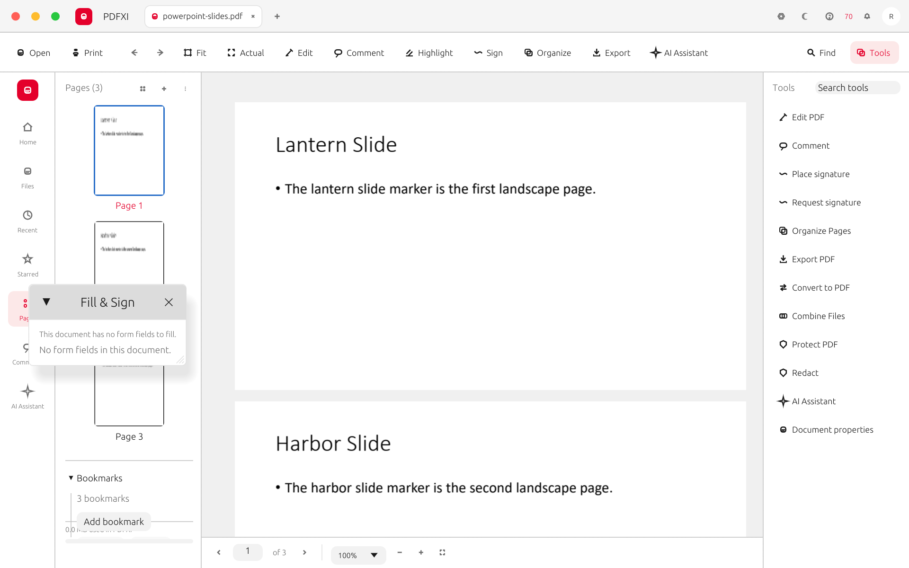

*Light theme, macOS caption buttons. Fill & Sign panel over the fixture, reporting that this document has no form fields. The fielded version is the fill-forms capture.*

### `light-macos-highlight.png`

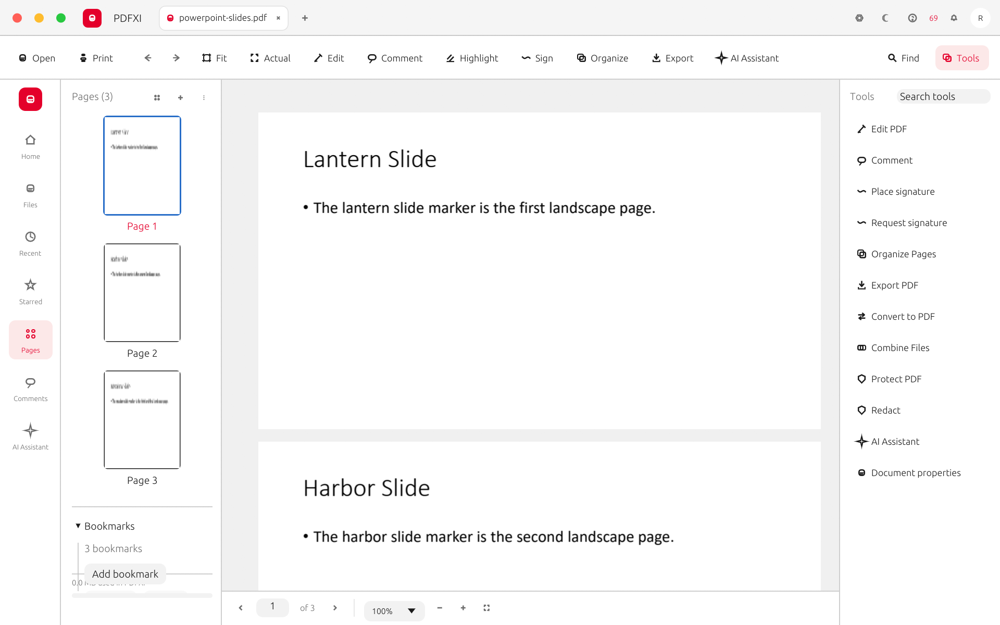

*Light theme, macOS caption buttons. Highlight tool selected in the toolbar. Same base viewer state as the Comment capture; a highlight needs a text selection, so no markup is visible here.*

### `light-macos-main.png`


*Light theme, macOS caption buttons. Main window: the three-page fixture is open, the Pages panel lists three thumbnails, three bookmarks are loaded, the tool rail is visible, and the Tools panel is open on the right. This is the base state every other capture starts from.*

### `light-macos-organize.png`

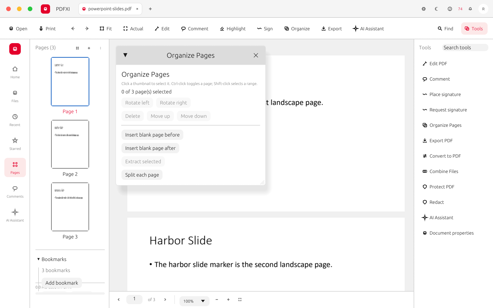

*Light theme, macOS caption buttons. Organize Pages panel: "0 of 3 page(s) selected", Rotate left/right, Delete, Move up/down, Insert blank page before/after, Extract selected, Split each page.*

### `light-macos-protect.png`

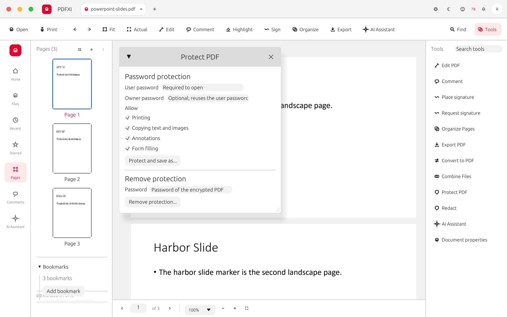

*Light theme, macOS caption buttons. Protect PDF panel: user and owner password fields, permission checkboxes (printing, copying text and images, annotations, form filling), Protect and save as, and Remove protection.*

### `light-macos-request-signature.png`

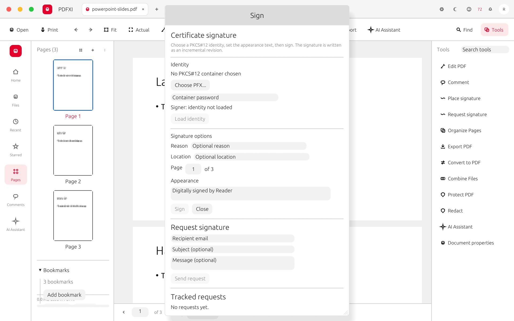

*Light theme, macOS caption buttons. Sign dialog again, with the request-signature section in view. It is visually identical to the sign capture, so it adds no distinct state of its own.*

### `light-macos-sign.png`


*Light theme, macOS caption buttons. Sign dialog: certificate signature (PKCS#12 identity, container password, reason, location, page, appearance, Sign/Close) and the request-signature form (recipient email, subject, message, Send request) with Tracked requests empty.*

## 3. Dark theme - Windows caption buttons (12)

Fixture: `fixtures/realworld/powerpoint-slides.pdf` (3 landscape pages) unless
the descriptor names another file.

### `dark-windows-ai.png`

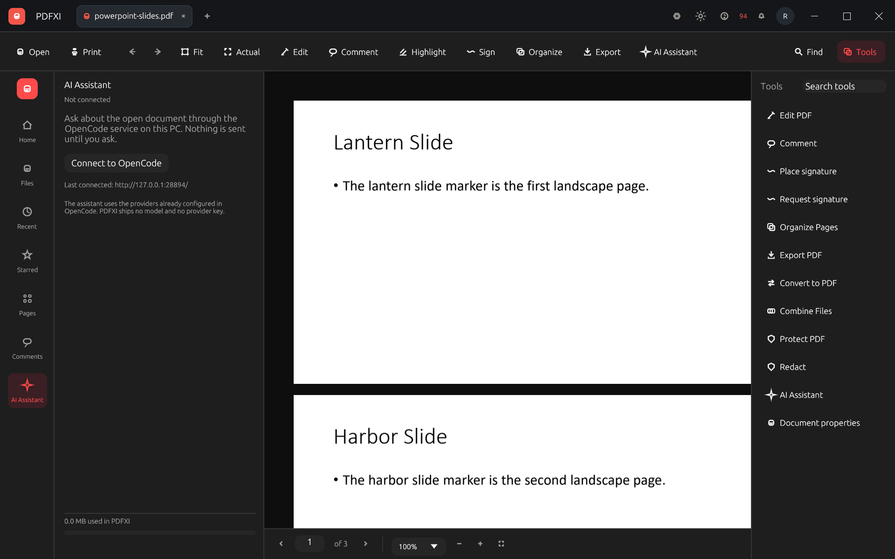

*Dark theme, Windows caption buttons. AI Assistant tool with the panel open: "Connect to OpenCode", the notice that a bounded excerpt is sent to the local service, the Ask box, and the Summarize / Key insights buttons. Not connected in this capture.*

### `dark-windows-comment.png`


*Dark theme, Windows caption buttons. Comment tool selected in the toolbar. The viewer, Pages panel and bookmarks are visible; no annotation panel is open, because it opens after a text or page-region selection. Treat this as the tool-selected state, not as proof a comment was placed.*

### `dark-windows-convert.png`

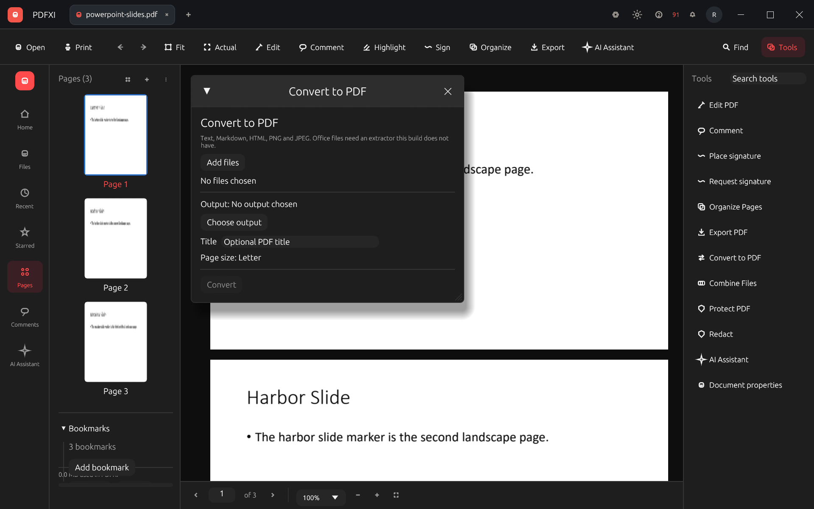

*Dark theme, Windows caption buttons. Convert to PDF panel: add files, output choice ("No output chosen"), title, open-after-converting, page size, and the Convert button.*

### `dark-windows-edit.png`

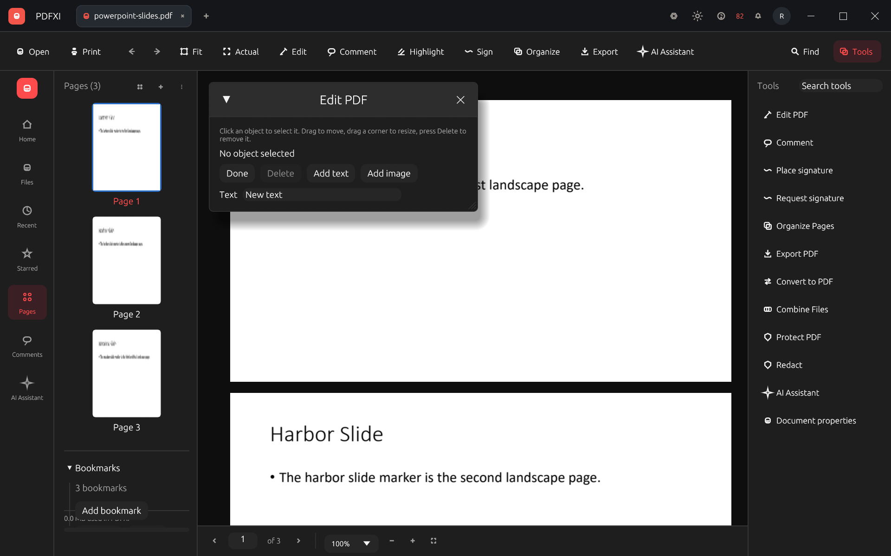

*Dark theme, Windows caption buttons. Edit PDF panel: "No text selected", Add text, Add image, Done and Close.*

### `dark-windows-export.png`


*Dark theme, Windows caption buttons. Export section at the bottom of the Tools panel: "Convert this PDF to" with the format list (Plain text shown) and the Export button.*

### `dark-windows-fill.png`

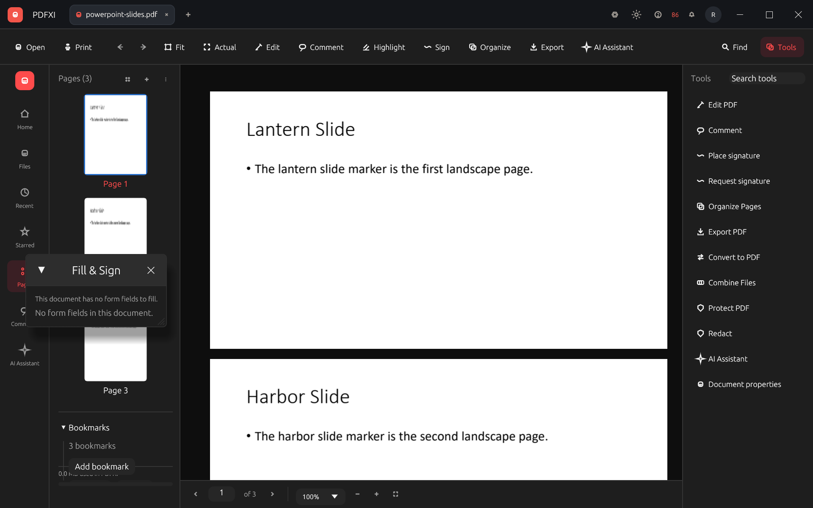

*Dark theme, Windows caption buttons. Fill & Sign panel over the fixture, reporting that this document has no form fields. The fielded version is the fill-forms capture.*

### `dark-windows-highlight.png`

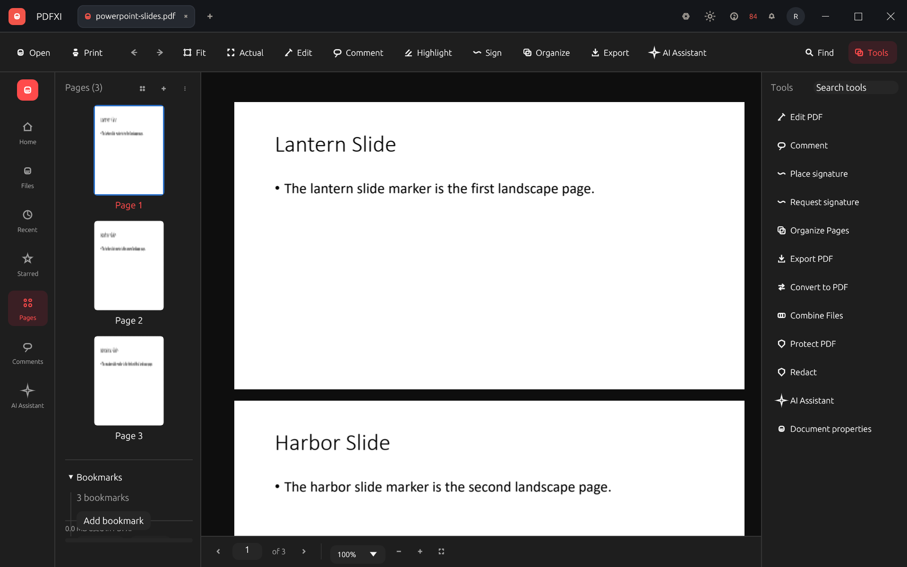

*Dark theme, Windows caption buttons. Highlight tool selected in the toolbar. Same base viewer state as the Comment capture; a highlight needs a text selection, so no markup is visible here.*

### `dark-windows-main.png`


*Dark theme, Windows caption buttons. Main window: the three-page fixture is open, the Pages panel lists three thumbnails, three bookmarks are loaded, the tool rail is visible, and the Tools panel is open on the right. This is the base state every other capture starts from.*

### `dark-windows-organize.png`

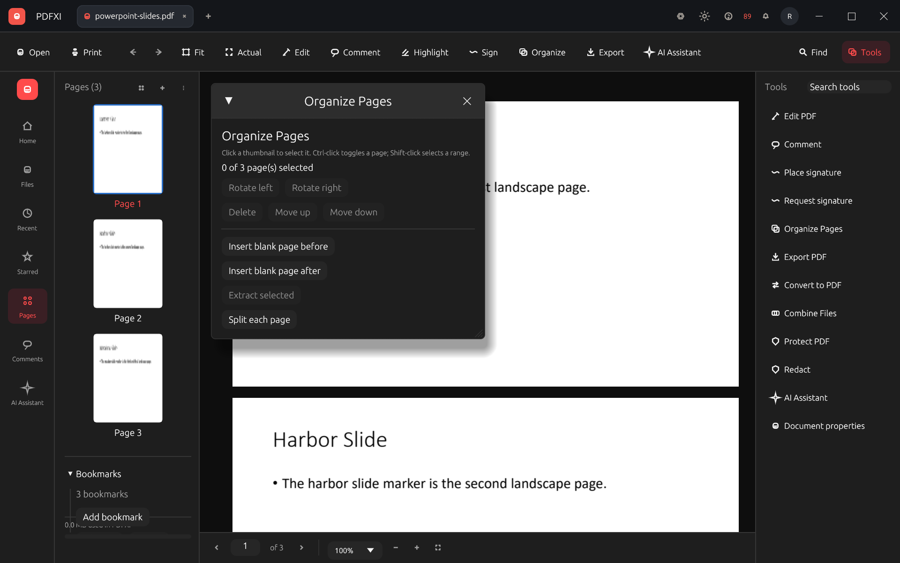

*Dark theme, Windows caption buttons. Organize Pages panel: "0 of 3 page(s) selected", Rotate left/right, Delete, Move up/down, Insert blank page before/after, Extract selected, Split each page.*

### `dark-windows-protect.png`

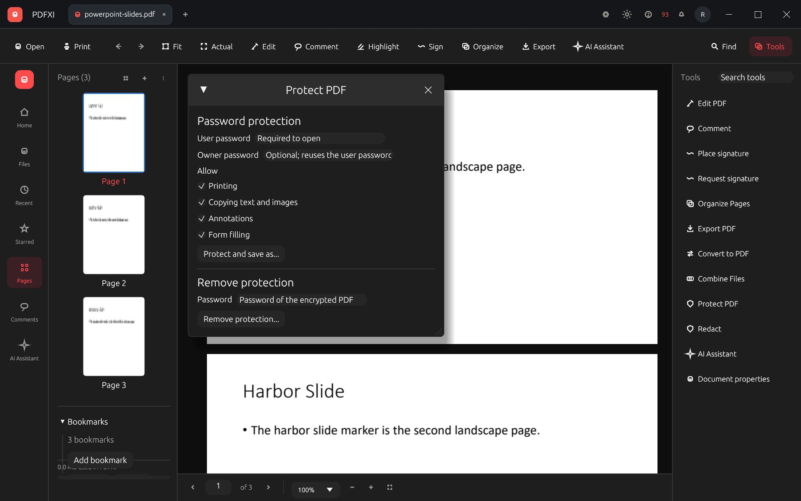

*Dark theme, Windows caption buttons. Protect PDF panel: user and owner password fields, permission checkboxes (printing, copying text and images, annotations, form filling), Protect and save as, and Remove protection.*

### `dark-windows-request-signature.png`


*Dark theme, Windows caption buttons. Sign dialog again, with the request-signature section in view. It is visually identical to the sign capture, so it adds no distinct state of its own.*

### `dark-windows-sign.png`

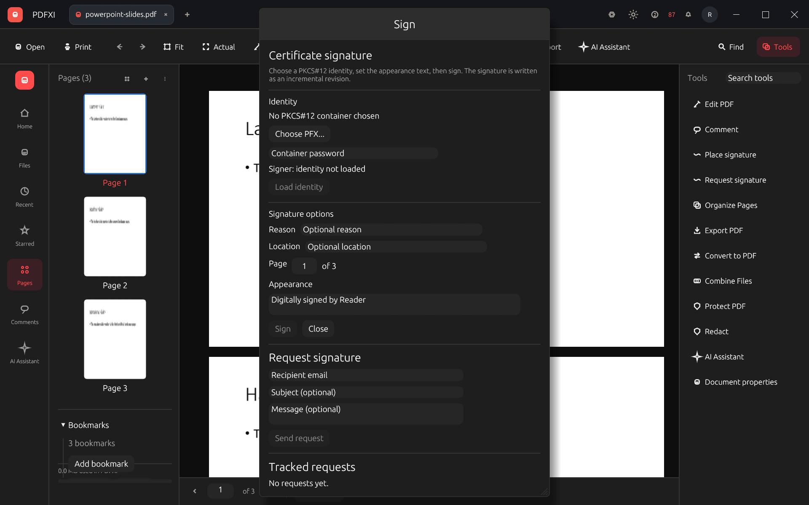

*Dark theme, Windows caption buttons. Sign dialog: certificate signature (PKCS#12 identity, container password, reason, location, page, appearance, Sign/Close) and the request-signature form (recipient email, subject, message, Send request) with Tracked requests empty.*

## 4. Dark theme - macOS caption buttons (14)

Fixture: `fixtures/realworld/powerpoint-slides.pdf` (3 landscape pages) unless
the descriptor names another file.

### `dark-macos-ai.png`

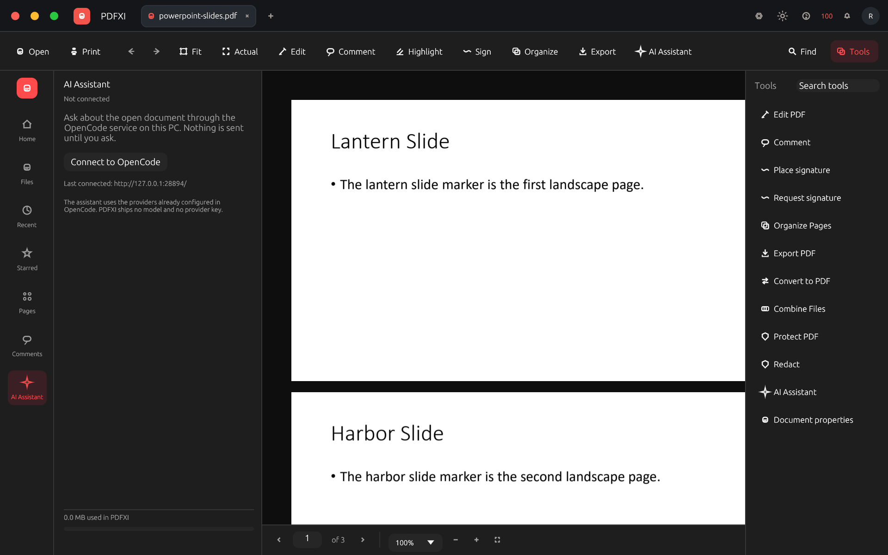

*Dark theme, macOS caption buttons. AI Assistant tool with the panel open: "Connect to OpenCode", the notice that a bounded excerpt is sent to the local service, the Ask box, and the Summarize / Key insights buttons. Not connected in this capture.*

### `dark-macos-comment.png`


*Dark theme, macOS caption buttons. Comment tool selected in the toolbar. The viewer, Pages panel and bookmarks are visible; no annotation panel is open, because it opens after a text or page-region selection. Treat this as the tool-selected state, not as proof a comment was placed.*

### `dark-macos-convert.png`

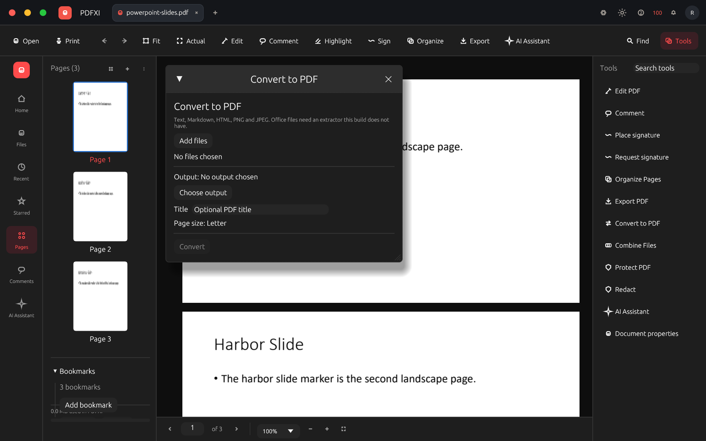

*Dark theme, macOS caption buttons. Convert to PDF panel: add files, output choice ("No output chosen"), title, open-after-converting, page size, and the Convert button.*

### `dark-macos-edit.png`

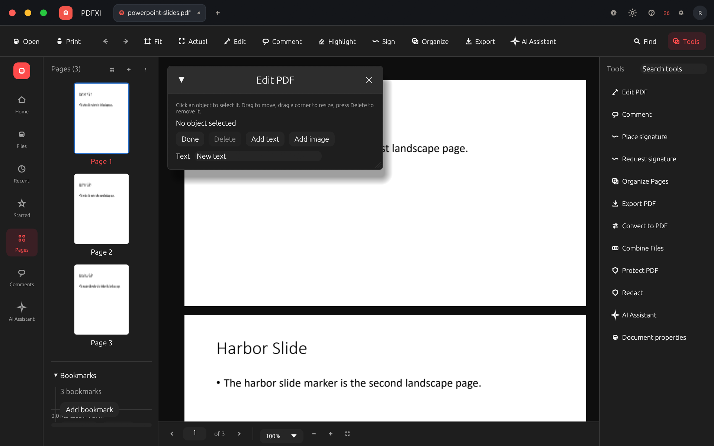

*Dark theme, macOS caption buttons. Edit PDF panel: "No text selected", Add text, Add image, Done and Close.*

### `dark-macos-export.png`

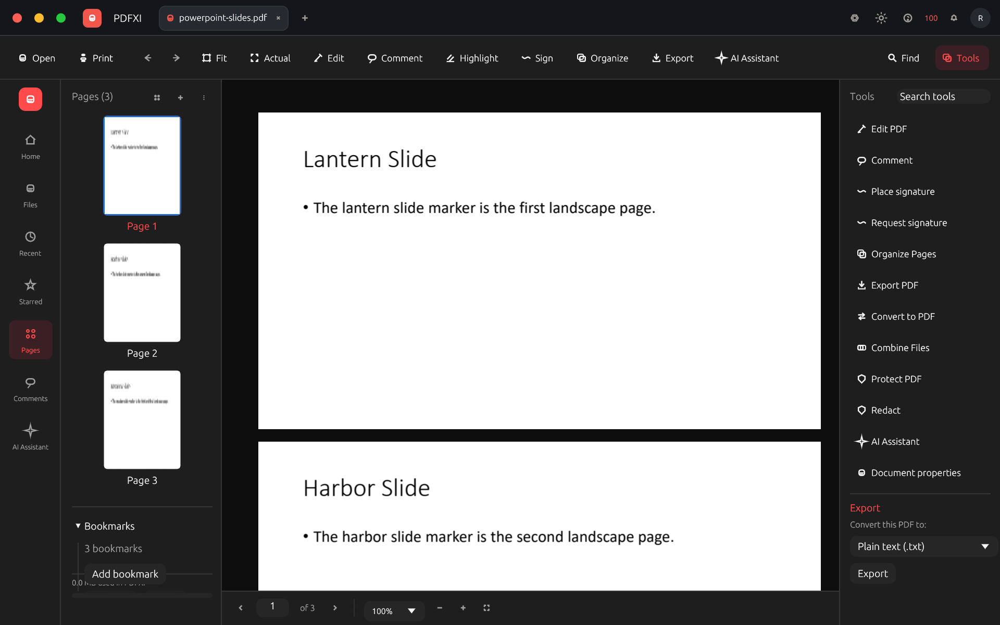

*Dark theme, macOS caption buttons. Export section at the bottom of the Tools panel: "Convert this PDF to" with the format list (Plain text shown) and the Export button.*

### `dark-macos-fill.png`

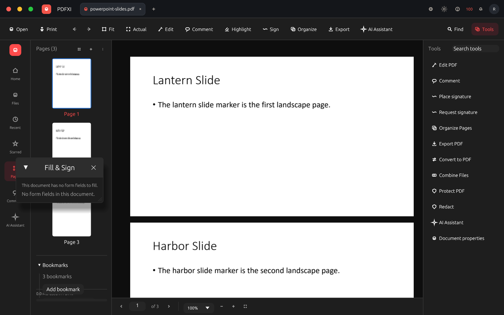

*Dark theme, macOS caption buttons. Fill & Sign panel over the fixture, reporting that this document has no form fields. The fielded version is the fill-forms capture.*

### `dark-macos-fill-forms.png`

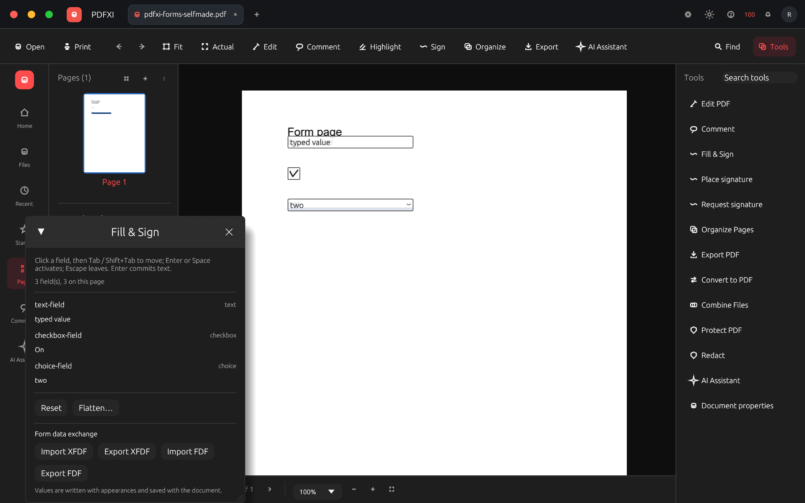

*Dark theme, macOS caption buttons. Fill & Sign over pdfxi-forms-selfmade.pdf: three fields filled (text "typed value", checkbox On, choice "two"), field list, Reset and Flatten, and the form data exchange buttons (Import/Export XFDF, Import/Export PDF).*

### `dark-macos-help.png`

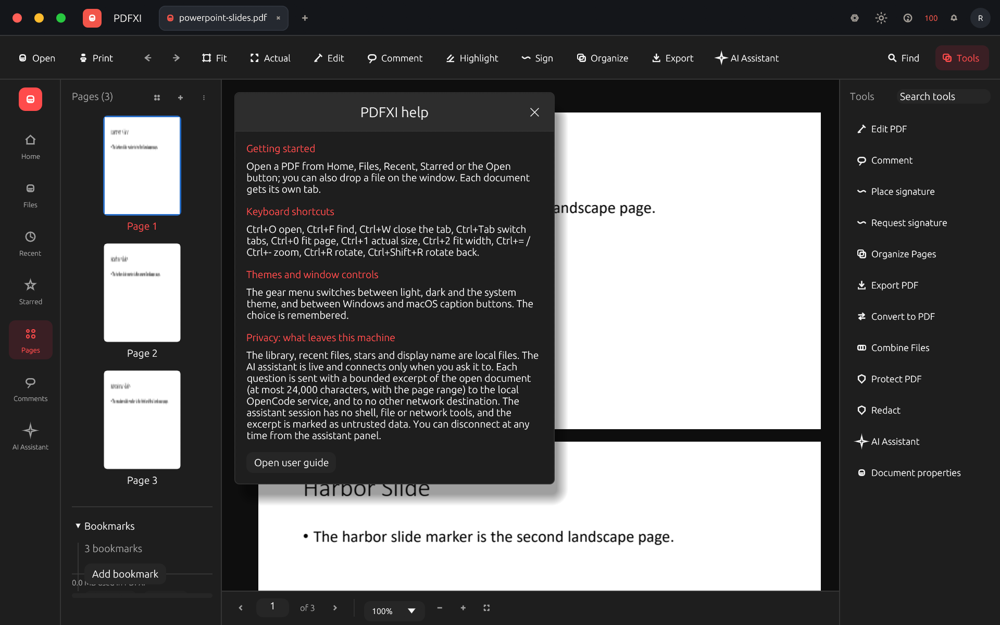

*Dark theme, macOS caption buttons. PDFXI help panel: getting started, keyboard shortcuts, themes and window controls, the privacy statement about what leaves the machine, and an Open user guide button.*

### `dark-macos-highlight.png`

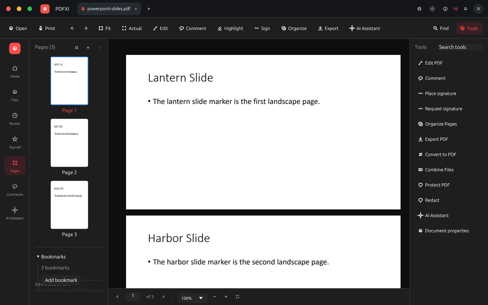

*Dark theme, macOS caption buttons. Highlight tool selected in the toolbar. Same base viewer state as the Comment capture; a highlight needs a text selection, so no markup is visible here.*

### `dark-macos-main.png`


*Dark theme, macOS caption buttons. Main window: the three-page fixture is open, the Pages panel lists three thumbnails, three bookmarks are loaded, the tool rail is visible, and the Tools panel is open on the right. This is the base state every other capture starts from.*

### `dark-macos-organize.png`

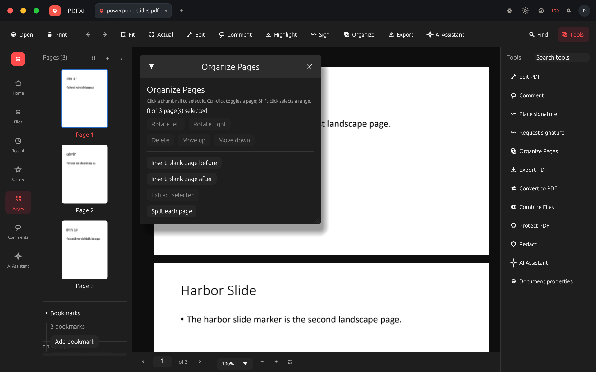

*Dark theme, macOS caption buttons. Organize Pages panel: "0 of 3 page(s) selected", Rotate left/right, Delete, Move up/down, Insert blank page before/after, Extract selected, Split each page.*

### `dark-macos-protect.png`

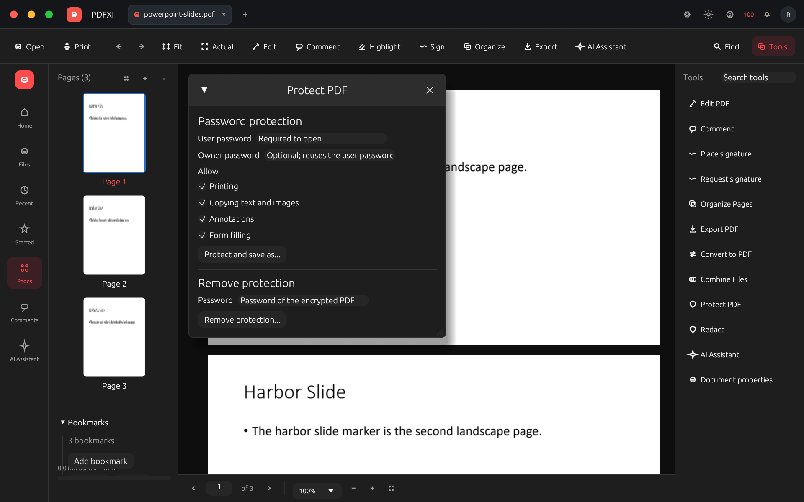

*Dark theme, macOS caption buttons. Protect PDF panel: user and owner password fields, permission checkboxes (printing, copying text and images, annotations, form filling), Protect and save as, and Remove protection.*

### `dark-macos-request-signature.png`


*Dark theme, macOS caption buttons. Sign dialog again, with the request-signature section in view. It is visually identical to the sign capture, so it adds no distinct state of its own.*

### `dark-macos-sign.png`

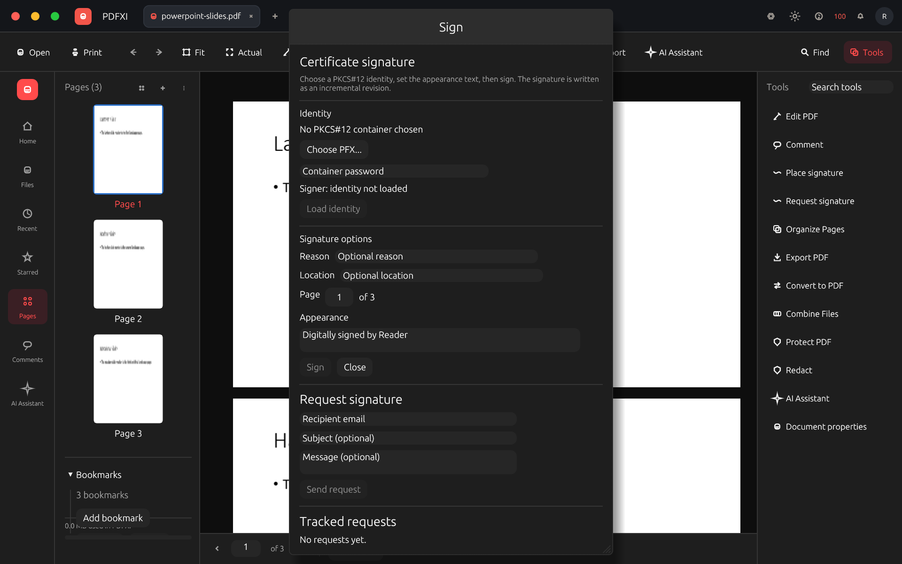

*Dark theme, macOS caption buttons. Sign dialog: certificate signature (PKCS#12 identity, container password, reason, location, page, appearance, Sign/Close) and the request-signature form (recipient email, subject, message, Send request) with Tracked requests empty.*

## 5. Other captures (2)

Fixture: `fixtures/realworld/powerpoint-slides.pdf` (3 landscape pages) unless
the descriptor names another file.

### `virtual-printer-captured.png`

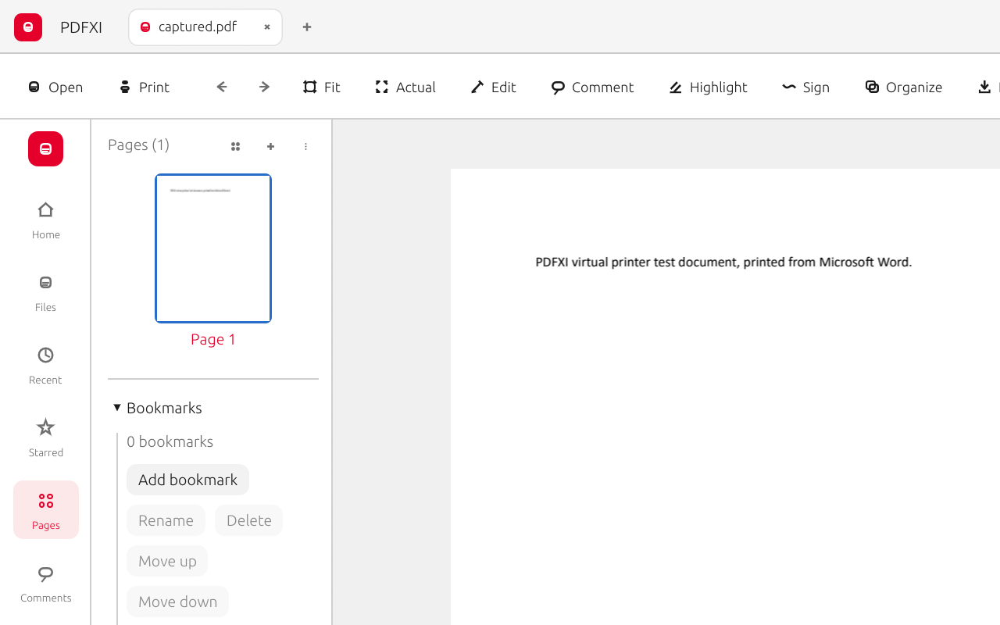

*The file captured from the PDFXI virtual printer (T-0275): Microsoft Word printed a document to the PDFXI PDF queue, the spooler wrote it to the capture port, and the installed viewer opens the captured one-page PDF showing the printed line. This is the origin evidence for CREATE-001 and CREATE-002.*

### `word-opens-docx.png`

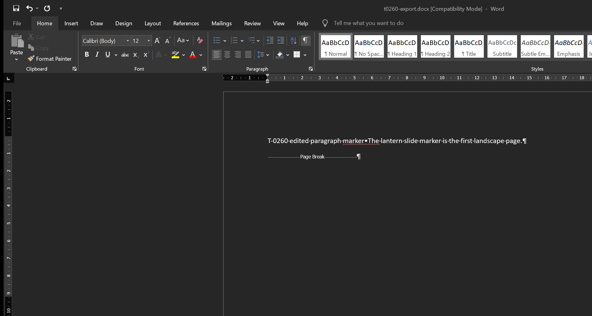

*Microsoft Word opening the exported DOCX (t0260-export.docx, Compatibility Mode) and showing the exported text, as the round-trip check for Word export.*

## Feature status register

Counts from `docs/features.toml`: 145 rows - 62 verified,
9 library, 72 model, 2 replaced.
The meanings come from ADR 0009.

| Status | Rows | Meaning |
| --- | --- | --- |
| erified | 62 | Runs on real document bytes and a user can reach it through the GUI or the CLI. |
| library | 9 | Real byte-level implementation over PDF documents and tested, but no user-reachable path or narrower than the product row. |
| model | 72 | In-memory model, plan, contract, or host-boundary stub; not a working product feature. |
| 
eplaced | 2 | Superseded by another row. |
| **total** | **145** | Canonical matrix: docs/features.toml |

### Verified rows (62)

| ID | Title | Domain |
| --- | --- | --- |
| `AUTO-009` | CLI info command with stable JSON output | Automation |
| `AUTO-010` | CLI text extraction for uncompressed content streams | Automation |
| `CREATE-001` | Create PDF from any printable application | Create |
| `CREATE-002` | Virtual PDF printer | Create |
| `CREATE-003` | Create PDF from images | Create |
| `CREATE-004` | Create PDF from plain text and Markdown | Create |
| `CREATE-005` | Create PDF from HTML | Create |
| `CREATE-009` | Combine multiple files into one PDF | Create |
| `MANAGE-001` | Document properties and XMP metadata | Document Management |
| `MANAGE-006` | Network and SharePoint-style integration | Document Management |
| `EDIT-001` | Edit text with paragraph reflow | Edit |
| `EDIT-004` | Add move resize and replace images | Edit |
| `EDIT-005` | Insert delete extract and replace pages | Edit |
| `EDIT-006` | Reorder rotate crop and resize pages | Edit |
| `EDIT-007` | Split and merge documents | Edit |
| `EDIT-013` | Redaction marks and permanent removal | Edit |
| `EDIT-015` | Repair malformed documents | Edit |
| `EXPORT-001` | Export PDF to editable Word | Export |
| `EXPORT-002` | Export PDF to editable Excel | Export |
| `EXPORT-003` | Export PDF to editable PowerPoint | Export |
| `EXPORT-004` | Export PDF to HTML | Export |
| `EXPORT-005` | Export PDF to RTF and plain text | Export |
| `EXPORT-006` | Export pages to JPEG PNG and TIFF | Export |
| `EXPORT-007` | Export accessible text and tagged content | Export |
| `FORMS-001` | Fill existing AcroForm fields | Forms |
| `FORMS-006` | Import and export FDF and XFDF | Forms |
| `FORMS-007` | Flatten forms and preserve appearance | Forms |
| `PKG-003` | Per-user Inno Setup installer (build, silent install, uninstall) | Platform |
| `PLAT-001` | Windows desktop application | Platform |
| `VIEW-020` | Shippable viewer package: GUI subsystem, icon, version resource, DPI manifest, bundled PDFium | Platform |
| `PRINT-001` | Preflight profiles checks and fixups | Print Production |
| `PRINT-007` | Page boxes bleed crop and printer marks | Print Production |
| `REVIEW-001` | Sticky note highlight underline strikeout and squiggly | Review |
| `REVIEW-004` | Comment threads replies and status | Review |
| `REVIEW-005` | Import export and print comments | Review |
| `REVIEW-006` | Email and shared review workflows locally | Review |
| `REVIEW-007` | Review tracker and participant status | Review |
| `SEC-001` | Open password and permissions password | Security |
| `SEC-008` | Sanitize document and remove hidden information | Security |
| `SEC-009` | Metadata and XMP scrubbing | Security |
| `SEC-012` | Protect PDF: apply and remove password protection | Security |
| `SEC-013` | Assistant tool lockdown and hostile-document hardening | Security |
| `STD-001` | PDF 1.0 through 2.0 compatibility | Standards |
| `STD-002` | Cross-reference tables and streams | Standards |
| `STD-007` | PDF/A conformance | Standards |
| `STD-008` | PDF/X conformance | Standards |
| `STD-009` | PDF/UA conformance | Standards |
| `STD-011` | Classic xref table and startxref parser | Standards |
| `STD-012` | Page tree traversal with inherited attributes | Standards |
| `VIEW-001` | Open and print PDF documents | View & Navigate |
| `VIEW-002` | Single page continuous and two-page layouts | View & Navigate |
| `VIEW-003` | Zoom pan loupe and fit modes | View & Navigate |
| `VIEW-004` | Rotate view and page display | View & Navigate |
| `VIEW-005` | Tabbed multi-document interface | View & Navigate |
| `VIEW-006` | Split and tile document windows | View & Navigate |
| `VIEW-007` | Page thumbnails and navigation pane | View & Navigate |
| `VIEW-008` | Bookmarks destinations and article threads | View & Navigate |
| `VIEW-009` | Attachments and embedded files | View & Navigate |
| `VIEW-011` | Links and named destinations | View & Navigate |
| `VIEW-016` | Open PDF and render pages in the viewer | View & Navigate |
| `VIEW-017` | Find text in a document and select copy text | View & Navigate |
| `VIEW-019` | Window controls, title bar settings, and persisted theme | View & Navigate |

### Not verified (83)

These rows exist in the matrix but are not reachable product features yet.

| ID | Title | Status | Domain |
| --- | --- | --- | --- |
| `CREATE-010` | Create and customize PDF Portfolios | `library` | Create |
| `EDIT-014` | Optimize and compress documents | `library` | Edit |
| `EXPORT-008` | Export to PDF/A PDF/X and PDF/E | `library` | Export |
| `FORMS-002` | Create text checkbox radio choice and button fields | `library` | Forms |
| `SEC-002` | RC4 and AES encryption handlers | `library` | Security |
| `SEC-005` | Sign and certify documents | `library` | Security |
| `STD-003` | Object streams and linearization | `library` | Standards |
| `STD-004` | Font embedding and CID fonts | `library` | Standards |
| `STD-010` | Incremental update and digital preservation | `library` | Standards |
| `ACCESS-001` | Tag tree and reading order editor | `model` | Accessibility |
| `ACCESS-002` | Alt text and table editor | `model` | Accessibility |
| `ACCESS-003` | Accessibility and PDF/UA checker | `model` | Accessibility |
| `ACCESS-004` | Reflow high contrast and keyboard navigation | `model` | Accessibility |
| `ACCESS-005` | Read aloud with system speech | `model` | Accessibility |
| `ACCESS-006` | Screen reader and accesskit integration | `model` | Accessibility |
| `AUTO-001` | Action Wizard create edit import export | `model` | Automation |
| `AUTO-002` | Batch processing and command sequences | `model` | Automation |
| `AUTO-003` | Droplets and watched folders | `model` | Automation |
| `AUTO-004` | Sandboxed Acrobat-compatible JavaScript subset | `model` | Automation |
| `AUTO-005` | CLI for every scriptable operation | `model` | Automation |
| `AUTO-006` | Local JSON API for automation | `model` | Automation |
| `AUTO-007` | Custom toolsets and commands | `model` | Automation |
| `AUTO-008` | WASM plugin host | `model` | Automation |
| `CREATE-006` | Create PDF from Microsoft Office via adapter | `model` | Create |
| `CREATE-007` | Scan to PDF with TWAIN and WIA | `model` | Create |
| `CREATE-008` | OCR scanned pages to searchable PDF | `model` | Create |
| `CREATE-013` | PostScript and Distiller-compatible ingestion | `model` | Create |
| `CREATE-014` | Watched-folder conversion | `model` | Create |
| `MANAGE-002` | Home recents favorites and collections | `model` | Document Management |
| `MANAGE-003` | Cross-file search and index | `model` | Document Management |
| `MANAGE-004` | PDF Portfolio management | `model` | Document Management |
| `MANAGE-005` | Version compare and history | `model` | Document Management |
| `EDIT-002` | Edit fonts size spacing and color | `model` | Edit |
| `EDIT-003` | Find and replace text across a document | `model` | Edit |
| `EDIT-008` | Headers footers and page numbering | `model` | Edit |
| `EDIT-009` | Watermarks and backgrounds | `model` | Edit |
| `EDIT-010` | Bates numbering | `model` | Edit |
| `EDIT-011` | Bookmarks links and attachments editing | `model` | Edit |
| `EDIT-012` | Flatten annotations and form fields | `model` | Edit |
| `EXPORT-009` | Export to PostScript | `model` | Export |
| `FORMS-003` | Field properties calculations and validation | `model` | Forms |
| `FORMS-004` | Form field actions and tab order | `model` | Forms |
| `FORMS-005` | Automatically recognize static form fields | `model` | Forms |
| `FORMS-008` | Reader-enable form filling and saving | `model` | Forms |
| `FORMS-009` | Distribute and collect forms locally | `model` | Forms |
| `FORMS-010` | Electronic signature fields and workflows | `model` | Forms |
| `MEDIA-001` | Audio and video annotations | `model` | Multimedia and 3D |
| `MEDIA-002` | HTML5 media replacement for Flash | `model` | Multimedia and 3D |
| `MEDIA-003` | U3D and PRC 3D viewing | `model` | Multimedia and 3D |
| `MEDIA-004` | Geospatial PDF support | `model` | Multimedia and 3D |
| `MEDIA-005` | Interactive actions and triggers | `model` | Multimedia and 3D |
| `PLAT-002` | macOS and Linux desktop builds | `model` | Platform |
| `PLAT-003` | Microsoft Office integration | `model` | Platform |
| `PLAT-004` | Browser integration | `model` | Platform |
| `PLAT-005` | Shell integration and file associations | `model` | Platform |
| `PLAT-006` | Deployment preferences and customization | `model` | Platform |
| `PLAT-007` | Unicode CJK and right-to-left text | `model` | Platform |
| `PRINT-002` | PDF/A PDF/X PDF/E and PDF/VT validation | `model` | Print Production |
| `PRINT-003` | ICC color management and output intents | `model` | Print Production |
| `PRINT-004` | Output preview and separations | `model` | Print Production |
| `PRINT-005` | Ink manager and overprint preview | `model` | Print Production |
| `PRINT-006` | Trapping presets and transparency flattening | `model` | Print Production |
| `PRINT-008` | Droplets hot folders and batch preflight | `model` | Print Production |
| `REVIEW-002` | Free text callout line arrow shape and cloud | `model` | Review |
| `REVIEW-003` | Pencil stamp and file attachment annotations | `model` | Review |
| `REVIEW-008` | Compare two PDFs and summarize changes | `model` | Review |
| `REVIEW-009` | Measurement distance area and perimeter | `model` | Review |
| `SEC-003` | Certificate encryption | `model` | Security |
| `SEC-004` | Digital IDs and certificate management | `model` | Security |
| `SEC-006` | Timestamp and signature validation | `model` | Security |
| `SEC-007` | Trust manager and revocation checks | `model` | Security |
| `SEC-010` | Security envelopes and attachment encryption | `model` | Security |
| `SEC-011` | Policy-based protection replacement | `model` | Security |
| `STD-005` | Transparency and blend modes | `model` | Standards |
| `STD-006` | Tagged PDF and structure tree | `model` | Standards |
| `VIEW-010` | Optional content layers | `model` | View & Navigate |
| `VIEW-012` | Full screen and presentation mode | `model` | View & Navigate |
| `VIEW-013` | Reflow and read aloud | `model` | View & Navigate |
| `VIEW-014` | PDF Portfolio browsing | `model` | View & Navigate |
| `VIEW-015` | Side-by-side compare view | `model` | View & Navigate |
| `VIEW-018` | Loupe magnifier and gesture navigation | `model` | View & Navigate |
| `CREATE-011` | Browser page capture extension | `replaced` | Create |
| `CREATE-012` | Email-to-PDF capture | `replaced` | Create |

## Blockers on record

- `chrono-unmaintained` - Blocker - chrono is unmaintained (RUSTSEC-2026-0543)
- `T-0055` - T-0055 concurrent duplicate-work conflict — RESOLVED
- `T-0108` - T-0108 — blocked by path overlap with T-0109
- `T-0156` - T-0156 - blocked by T-0152 claim overlap (resolved by sequencing)
- `T-0202-code-signing` - Blocker: code signing (T-0202)
- `T-0215-word-com` - T-0215: Word COM save/export hang (RESOLVED)
- `T-0241-rsa-advisory` - T-0241 blocker - RUSTSEC-2023-0071 in `rsa 0.9.10`
- `T-0253` - T-0253 blocker: evidence and capture paths are denied to lane-app
- `T-0253-grounding` - T-0253 grounding blocker: MCP tools attach but the model never sees them
- `T-0253-harness-coverage` - Blocker: T-0253 harness coverage edit denied (integrator permissions)
- `T-0255-outline-bridge` - T-0255 blocker: no real-PDF outline reader/writer bridge
- `T-0260A-fuzz-toolchain` - T-0260A fuzz toolchain blocker
- `T-0260B-budget` - T-0260B real-corpus save budget blocker
- `T-0261-claim-gate` - T-0261 formal claim refused by dependency gate
- `T-0262-inno-installer` - T-0262: Inno Setup aborted with "Access is denied" in %TEMP% (RESOLVED)

## Sources

- `docs/design/FEATURE_ACCEPTANCE.md` - the A-/O- acceptance matrix.
- `docs/features.toml` - the canonical feature matrix enforced by the gates.
- `docs/evidence/release/T-0262.md` - installer, shortcut, captures, assistant turns.
- `docs/evidence/ui/` - per-task UI evidence documents.
- `docs/decisions/0009-feature-status-honesty.md` - what each status means.
- `docs/evidence/ui/final/` - the PNGs embedded above.

---

Generated by `scripts/build-review-md.ps1`: 57 captures, 145 feature rows, 40 acceptance items.

